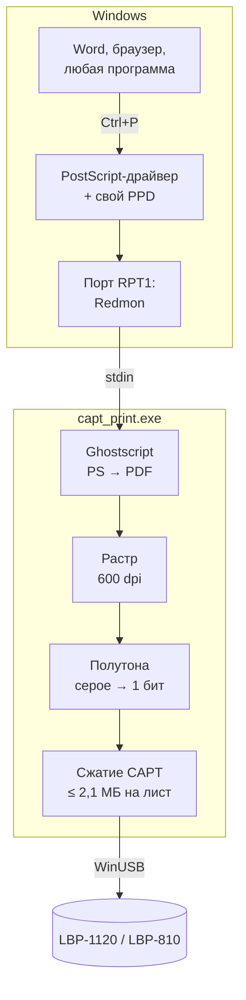

# Print Restore

**Canon LBP-1120 и LBP-810 снова печатают на Windows 10 и 11 x64.**

Canon так и не выпустила 64-битный драйвер для этих принтеров: последний официальный был для 32-битных XP и Vista. Print Restore — это свой драйвер печати для Windows. Он говорит с принтером на его родном протоколе CAPT по USB и встраивается в систему как обычный принтер, так что печать идёт из любой программы через Ctrl+P.

В основе протокольного ядра лежит драйвер [Nicolas Boichat](http://www.boichat.ch/nicolas/capt/) для Linux (2004, GPL), который сам вырос из работы Rildo Pragana. Из него перенесены на Python сжатие растра и порядок команд CAPT. Всё остальное, от интеграции в Windows до установщика, написано в этом проекте и перечислено ниже.

> Версия **v55** · Windows 8.1 / 10 / 11 x64 · проверено на трёх ОС и двух экземплярах LBP-1120 плюс LBP-810

---

## Как проходит страница



---

## Что добавлено к драйверу Boichat

У Boichat был фильтр печати для Linux: на вход растр, на выход поток CAPT в принтер. Здесь из него взяты сжатие и последовательность команд. Остальное сделано заново.

### Работа в Windows

- **Печать из любой программы.** Стандартный PostScript-драйвер Windows со своим файлом описания принтера (PPD), порт Redmon и Ghostscript вместо фильтров CUPS.
- **Свой USB-драйвер.** WinUSB-драйвер на базе libwdi, подписанный самоподписанным сертификатом. Сертификат убирается из корневого хранилища сразу после установки.
- **Окно настроек печати.** В «Свойства принтера → Дополнительно»: режим настроек, быстрые наборы, разрешение 600 или 300 dpi, полутона, плотность тонера, экономия тонера, улучшение изображения, яркость, контраст, ручной дуплекс, сброс счётчика картриджа.
- **Несколько принтеров сразу.** Если подключено два LBP-1120, у каждого своя очередь по серийному номеру. У LBP-810 отдельная очередь и свой счётчик.

### Качество печати

- **Растр 600 и 300 dpi** через pypdfium2 вместо PyMuPDF: в готовом exe нет зависимостей под AGPL.
- **Восемь режимов полутонов:** от гладкого Флойда–Стейнберга до матрицы Байера и растровой сетки, а также режим `smart`: текст чёткий, фото рассеянными точками.
- **Поправка тонов, яркость, контраст.** Серые фото из Word больше не выходят чёрными: передаточные функции драйвера запекаются в картинку ещё в Ghostscript.
- **Тяжёлые страницы не обрываются.** У принтера маленькая память. Если сжатая страница больше 2,1 МБ, драйвер сам переходит на более лёгкий режим полутонов. Отправка пакетов выровнена так, чтобы принтер не оставался без данных посреди листа.
- **Форматы A4, A5, A6, A7 и свой размер бумаги**, формат определяется по странице.
- **Цветное печатается в оттенках серого**, пустые страницы можно пропускать, копии из Word учитываются.
- **Ручной дуплекс:** сначала нечётные страницы, потом окно с подсказкой, как перевернуть стопку, и чётные.

### Надёжность

- **Понятные ошибки.** Драйвер читает биты состояния принтера и пишет уведомление с причиной: нет бумаги, замятие, открыта крышка, нет картриджа.
- **Повтор при сбое подачи.** Если лист задело при захвате, драйвер переподключается и печатает эту страницу ещё раз.
- **Выдернули USB посреди печати** — уведомление сразу, без минутного ожидания.
- **Одно задание за раз.** Следующая страница готовится заранее, пока принтер печатает предыдущую, поэтому между заданиями нет простоя.
- **Журнал с ротацией:** `C:\ProgramData\CaptPrinter\capt_redmon.log`.

### Счётчик картриджа

- **Ресурс 2500 листов (EP-22)**, у LBP-810 свой счётчик.
- **Уведомления на 80, 95 и 100%** с кнопкой «Картридж заменён — обнулить».
- **Показ и сброс** через `Counter.cmd`, другой ресурс задаётся командой `printer_counter.ps1 -Rated 3000`.

### Установщик

- **Мастер на русском и английском:** определяет модель по USB, ставит Ghostscript, Redmon, драйверы и очереди, в конце предлагает пробную страницу с серийным номером принтера.
- **Честный итог.** Если установка не удалась, мастер пишет причину и путь к журналу, а не «Установка завершена».
- **Проверка загрузок.** Ghostscript проверяется по SHA-256 или по подписи «Artifex Software, Inc.». Файл, выбранный вручную, без подписи не запускается.
- **Готов к Windows 11.** Распознаёт «Режим защищённой печати» и сразу говорит, как его выключить.
- **Удаляет только своё.** Ghostscript и Redmon снимаются, только если их поставил этот установщик.
- **Обычный пользователь:** установка работает с паролем администратора. Проверено вместе с SmartScreen.
- **Статистика установок по желанию:** анонимно, отключается галочкой. Состав данных описан в README пакета.

---

## Сборка из исходников

Готовый установщик в этом репозитории не публикуется. Собрать драйвер можно самому:

```powershell
pip install pyinstaller==6.22.2 pyusb==1.3.1 libusb-package==1.0.30.0 pypdfium2==5.14.0 pillow==12.3.0 numpy==2.5.1 Windows-Toasts==1.3.1
pyinstaller --clean capt_print.spec
```

Подробности в [`BUILD.txt`](BUILD.txt). Мастер установки собирается в Inno Setup 7 из `LBP1120_InnoSetup.iss`.

---

## Благодарности и лицензии

- **Протокольное ядро:** Nicolas Boichat, на основе работы Rildo Pragana. GNU GPL v2. Этот проект распространяется на тех же условиях, см. [`LICENSE`](LICENSE).
- **Ghostscript** (Artifex, AGPL) скачивается при установке и в репозиторий не входит.
- **RedMon** (Ghostgum Software, GPL) — монитор портов печати.
- **libwdi / libusb** — WinUSB-драйвер, лицензии в `usb_driver/license`.
- **pypdfium2, Pillow, pyusb, libusb-package, Windows-Toasts, PyInstaller, Inno Setup.**

Canon, LBP и CAPT — торговые марки Canon Inc. Проект с Canon не связан.

---

Блог проекта: [boosty.to/printrestore](https://boosty.to/printrestore)
